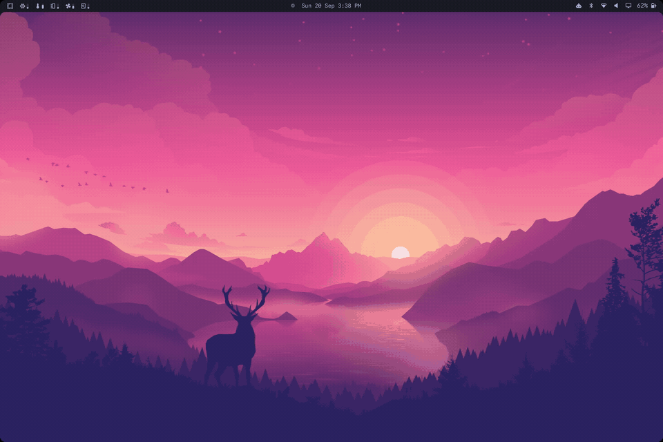

# Sysmon

A small system monitor for the Omarchy bar. Each pill shows one live reading;
click it for a card with the details. You can put several pills side by side
for CPU, GPU, temperature, memory, fan speed, and disk space.



## Install

Requires Omarchy with its Quickshell shell. Install and enable it with:

```bash
omarchy plugin add https://github.com/turbineBMW/Sysmon --enable
```

The first pill shows CPU usage on the left side of the bar. Left-click a pill
to open its card. Right-click any pill for a menu that chooses which stats are
on the bar and opens `btop` when it is installed. The plugin
reads Linux's `/proc` and `/sys` data and uses standard system tools to find
disks and sensors; it does not install packages or change system settings.
Some hardware does not report a temperature or fan speed, so those readings
may be unavailable. The GPU pill works with AMD (`amdgpu`), Intel (`i915`,
`xe`) and Qualcomm (`msm`) graphics. NVIDIA's driver reports no GPU load, so
NVIDIA cards show no reading.

## Choose your pills

Right-click any Sysmon pill and tick the stats you want. Each one gets its own
pill, kept in the same order as the menu. The last pill can't be unticked,
since it is the only way back into the menu.

You can also edit the layout by hand. Sysmon allows several copies of its bar
widget. In
`~/.config/omarchy/shell.json`, add the entries you want to the existing
`bar.layout.left` array, for example:

```json
[
  { "id": "turbinebmw.sysmon", "stat": "cpu" },
  { "id": "turbinebmw.sysmon", "stat": "gpu" },
  { "id": "turbinebmw.sysmon", "stat": "temperature" },
  { "id": "turbinebmw.sysmon", "stat": "memory" },
  { "id": "turbinebmw.sysmon", "stat": "fan" },
  { "id": "turbinebmw.sysmon", "stat": "disk", "mount": "/" }
]
```

Each pill can set `warningThreshold` and `criticalThreshold` in percent. A fan
pill can set `fanMaxRpm`, the speed it treats as a full meter. A disk pill can
set `mount` to a different filesystem. The defaults work without any edits.

## Remove

```bash
omarchy plugin remove turbinebmw.sysmon
```

Sysmon keeps no separate data files. This Omarchy version is adapted from the
willshell monitor and is released under the [MIT license](LICENSE).
Implementation notes are in [DEVELOPING.md](DEVELOPING.md).
